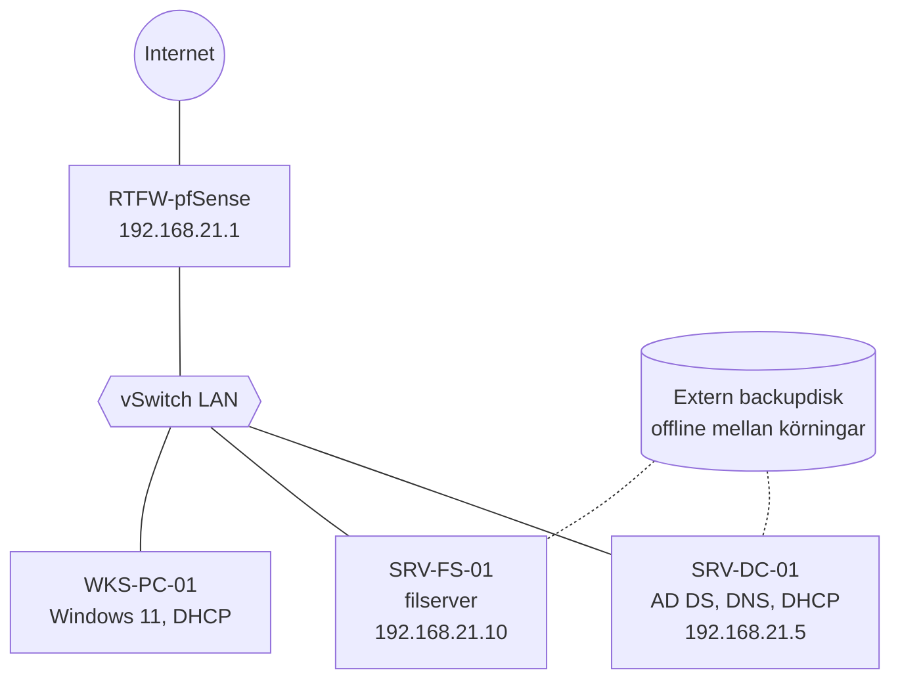
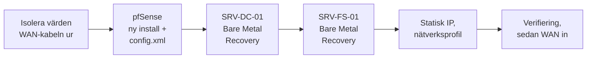

# Disaster Recovery i Hyper-V – GTRIX

Vi byggde en liten Windows-miljö i Hyper-V, skrev en Disaster Recovery Plan, tog backup – och raderade sedan alla virtuella maskiner. Miljön återställdes två gånger: först som efter ett ransomware-angrepp, sedan till en helt annan dator som efter en hårdvarukrasch. Projektet gjordes i kursen Data/IT-säkerhet (Moln- och virtualiseringsspecialist, Campus Mölndal, maj 2026).

> Företaget GTRIX och domänen `gtrix.se` är fiktiva och användes bara i en isolerad labbmiljö.

## Innehåll

| Dokument | Innehåll |
| --- | --- |
| [Disaster Recovery Plan](docs/disaster-recovery-plan.md) | Omfattning, RTO och RPO, konsekvensanalys, riskanalys, roller, miljö, backupstrategi, incidentprocess, kommunikation |
| [Procedur A – ransomware](docs/procedur-a-ransomware.md) | Radera den smittade miljön och återställa allt från backup på samma värd |
| [Procedur B – ny värd](docs/procedur-b-ny-vard.md) | Bygga upp miljön på en annan dator |
| [Resultat och lärdomar](docs/resultat-och-lardomar.md) | Uppmätta tider, utvärdering och tekniska upptäckter |
| [CHANGES.md](CHANGES.md) | Vad som ändrats vid portföljarbetet |

## Uppgiften

| Del | Vad vi gjorde |
| --- | --- |
| 1. Uppstart | Byggde pfSense, en domänkontrollant och en filserver med 20 användare, skrev planen och tog backup |
| 2. Ransomware | Raderade alla VM:ar och återställde dem från backup |
| 3. Hårdvarukrasch | Raderade alla VM:ar igen och återställde dem till en annan dator |

## Mitt bidrag

Gemensamt grupparbete med två gruppmedlemmar, där alla deltog i alla delar: miljön, planen, backupen och båda återställningarna. Min roll i planen var **Incident Commander**, som aktiverar planen och leder återställningen.

## Teknik

Hyper-V på Windows 11 · Windows Server 2022 (inloggning i återställningsmiljön testad även med 2025) · Active Directory, DNS och DHCP · pfSense, med återställning av `config.xml` · Windows Server Backup: Bare Metal Recovery, System State och VSS · Windows återställningsmiljö (WinRE)

## Arkitektur

| Maskin | Roll | IP-adress |
| --- | --- | --- |
| RTFW-pfSense | Router och brandvägg | 192.168.21.1 (LAN), DHCP (WAN) |
| SRV-DC-01 | AD DS, DNS, DHCP | 192.168.21.5 |
| SRV-FS-01 | Filserver | 192.168.21.10 |
| WKS-PC-01 | Testklient | DHCP, 192.168.21.100–199 |

## Planen i korthet

| Del | Innehåll |
| --- | --- |
| Mål | RPO högst 24 timmar, RTO högst 4 timmar |
| Största risk | Ransomware, riskvärde 20 av 25 |
| Backup | Windows Server Backup varje natt, enligt 3-2-1-regeln |
| Skydd mot ransomware | Backupdisken är fysiskt urkopplad mellan körningarna (air-gap) |
| Incidentprocess | Upptäckt → aktivering → inneslutning → rensning → återställning → utvärdering |
| Kommunikation | Kanaler utanför företagets e-post; anmälan till IMY inom 72 timmar om personuppgifter läckt |

## Återställningen

Ordningen spelar roll. Filservern startas först när domänkontrollanten är helt igång, annars fungerar varken domänanslutning eller inloggning. WAN-kabeln kopplas in sist, efter virusskanning.

## Resultat

| Mått | Mål | Utfall |
| --- | --- | --- |
| RPO | 24 timmar | Uppfyllt |
| RTO | 4 timmar | Uppfyllt med god marginal |
| Bare Metal Recovery | – | Cirka 20 minuter per VM |
| System State-återställning | – | Cirka 40 minuter |

Tiderna kommer från gruppens anteckningar. Det finns inga skärmbilder från återställningarna.

## Felsökning

Problem och upptäckter under återställningarna:

| Problem | Lösning |
| --- | --- |
| Återställda servrar tappade sin statiska IP-adress | Nya VM:ar får nya nätverkskort och MAC-adresser, så kortet startar på DHCP. Statisk IP sattes manuellt på det nya kortet (ofta *Ethernet 2*). |
| Systemvolymen gick inte att återställa inifrån Windows | Windows Server Backup kan inte skriva över en aktiv systemvolym. Återställningen måste startas från ISO:n i återställningsmiljön (Bare Metal Recovery). |
| Inloggningen mot den delade backupmappen krävde olika format | `domän\användare` på Server 2022 och `användare@domän` på Server 2025. Testa först med `Shift + F10` och `dir \\server\share`. |

Kontroller som planen kräver för att undvika problem: de virtuella switcharna ska heta exakt `WAN` och `LAN` som innan, och Network Location Awareness ska visa **Domain Network**, så att serverns brandvägg inte blockerar trafik.

## Säkerhet

- **Air-gap:** Windows Server Backup saknar oföränderlig lagring, så backupdisken hålls fysiskt urkopplad när den inte används.
- **Inneslutning först:** WAN-kabeln dras ur och de virtuella switcharna stängs av innan något återställs.
- **Inget återanvänds:** smittade VM:ar och deras VHDX-filer raderas helt. Allt återställs från en backup som inte var ansluten under angreppet.
- **Lösenord utanför planen:** administratörs- och DSRM-lösenord förvaras utskrivna i ett kassaskåp, inte i dokumentet.
- **pfSense-konfigurationen** innehåller känsliga uppgifter och förvaras på ett krypterat USB-minne. Den hör inte hemma i ett git-repo.
- **Efter ett riktigt intrång** räcker det inte att återställa. Lösenorden för administratörer, tjänstekonton och `krbtgt` måste också bytas. Se rättelsen i [planen](docs/disaster-recovery-plan.md#7-underhåll-och-test).

## Lärdomar

- **En backup är inte bevisad förrän den har återställts.** Felen vi stötte på syntes bara när vi faktiskt återställde.
- **Små detaljer stoppar en återställning:** namnet på en vSwitch, en ny MAC-adress, formatet på ett användarnamn.
- **Ordning och isolering** är lika viktiga som själva backupen.
- **Nästa gång** skulle jag lägga varje servers IP-inställningar som en färdig checklista i planen. Jag skulle också hålla planen entydig om vilken server som delar ut DHCP. Båda framgick av testerna.

## Återskapa labbet

1. Slå på Hyper-V på en Windows 11 Pro-dator och skapa switcharna `WAN` (External) och `LAN` (Internal).
2. Skapa VM:arna enligt [planen](docs/disaster-recovery-plan.md#4-miljö): pfSense med två nätverkskort, SRV-DC-01 och SRV-FS-01 med Windows Server.
3. Installera AD DS, DNS och DHCP på SRV-DC-01 och anslut SRV-FS-01 och en klient till domänen.
4. Installera Windows Server Backup på båda servrarna och ta en fullständig backup till en extern disk eller en nätverksmapp. Spara pfSense `config.xml` separat.
5. Radera VM:arna och följ [procedur A](docs/procedur-a-ransomware.md). Mät tiden.
6. Gör om det på en annan dator med [procedur B](docs/procedur-b-ny-vard.md).
