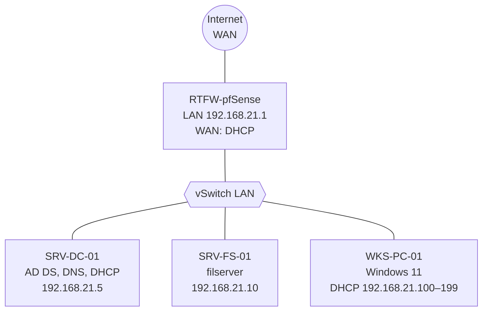
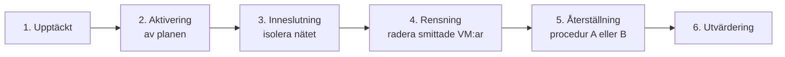

# Disaster Recovery Plan – GTRIX

Planen skrevs av vår grupp (tre personer) i kursen Data/IT-säkerhet, version 4.0 den 22 maj 2026. Här är den omskriven till Markdown. Gruppmedlemmarnas namn är ersatta med roller. Själva återställningsstegen finns i två egna dokument:

- [Procedur A – ransomware](procedur-a-ransomware.md)
- [Procedur B – återställning till ny värd](procedur-b-ny-vard.md)

## 1. Omfattning

Planen täcker den Hyper-V-baserade miljön för det fiktiva företaget GTRIX:

| Del | Tjänst |
| --- | --- |
| Nätverksgateway och brandvägg | pfSense |
| Identitet och katalogtjänst | Active Directory på Windows Server 2022 |
| Fildelning | Filserver på Windows Server 2022 |
| Klienter | Windows 11, adresser via DHCP |

### Målvärden

| Mål | Värde | Hur |
| --- | --- | --- |
| RPO (Recovery Point Objective) | Högst 24 timmar | Daglig inkrementell backup |
| RTO (Recovery Time Objective) | Högst 4 timmar | Från bekräftat avbrott till att routing, inloggning och filåtkomst fungerar |

## 2. Konsekvensanalys och risker

### Konsekvensanalys (BIA)

- **SRV-DC-01 nere:** ingen kan logga in eller nå interna resurser. DNS och DHCP ligger också nere, så nätverket stannar.
- **SRV-FS-01 nere:** pågående arbete stoppas och verksamhetens filer går inte att nå.

### Riskanalys

Riskvärde = sannolikhet × konsekvens, båda på en skala 1–5.

| Hot | Sannolikhet | Konsekvens | Riskvärde | Åtgärd |
| --- | --- | --- | --- | --- |
| Ransomware | 4 | 5 | 20 | Backuper lagras offline (air-gap), VSS-medveten backup, nätverket isoleras vid utbrott |
| Total hårdvarukrasch på värden | 2 | 5 | 10 | Bare Metal Recovery till annan hårdvara från extern lagring, dokumenterad Hyper-V-konfiguration |
| Mänskliga faktorn, till exempel felaktig radering | 3 | 3 | 9 | Återställning av enskilda filer med Windows Server Backup, utan att rulla tillbaka hela systemet |

## 3. Roller vid kris

| Roll | Ansvar |
| --- | --- |
| Incident Commander (jag) | Aktiverar planen, leder återställningen, samordnar kommunikationen och ser till att stegen följs |
| Infrastructure & Hyper-V Lead (gruppmedlem) | Hyper-V-värden, virtuella switchar, nätverk, hårdvara och routing i pfSense |
| Backup & Storage Administrator (gruppmedlem) | Kontrollerar att backuperna är hela, återställer VM:ar och filer, ser till att ingen smitta förs tillbaka |
| Sysadmin (gruppmedlemmar) | Kontrollerar AD, DNS, GPO:er, behörigheter och data på filservern efter återställningen |

## 4. Miljö

| Uppgift | Värde |
| --- | --- |
| Domän | `gtrix.se` (labbdomän) |
| LAN | 192.168.21.0/24 |
| Gateway | 192.168.21.1 |

### IP-plan

| Maskin | Roll | IP-adress | DNS | Virtuell switch |
| --- | --- | --- | --- | --- |
| RTFW-pfSense | Router och brandvägg | LAN 192.168.21.1, WAN via DHCP | – | WAN (External) och LAN (Internal) |
| SRV-DC-01 | AD DS, DNS, DHCP | 192.168.21.5 | 127.0.0.1 | LAN |
| SRV-FS-01 | Filserver | 192.168.21.10 | 192.168.21.5 | LAN |
| WKS-PC-01 | Testklient, Windows 11 | DHCP | 192.168.21.5 | LAN |

DHCP-scopet `GTRIX-Clients` finns på SRV-DC-01: 192.168.21.100–199, mask 255.255.255.0, lease 8 timmar, router 192.168.21.1 och DNS 192.168.21.5.

### Virtuella maskiner i Hyper-V

| VM | Operativsystem | Generation | vCPU | RAM | Övrigt |
| --- | --- | --- | --- | --- | --- |
| pfSense | pfSense (FreeBSD) | 1 | 2 | 1 GB | Två nätverkskort, WAN och LAN |
| SRV-DC-01 | Windows Server 2022 | 2 | 2 | 4 GB | Integration Services påslagna |
| SRV-FS-01 | Windows Server 2022 | 2 | 2 | 4 GB | Egen datavolym för de delade mapparna |

## 5. Backupstrategi

- **Program:** Windows Server Backup, som är inbyggt i Windows Server.
- **Metod:** VSS-medveten backup. Volume Shadow Copy Service gör en applikationskonsekvent ögonblicksbild av Active Directory-databasen medan servern kör.
- **Schema:** backup varje natt klockan 01:00, med målet att spara en veckas versioner.

> **Rättelse vid portföljarbetet:** originalet sa att VSS fryser databasen "i en millisekund" och "helt skyddar mot USN rollback". VSS-ögonblicksbilden är konsekvent, men skyddet mot USN rollback kommer av att domänkontrollanten återställs från en backup som Windows känner igen (System State eller Bare Metal), inte från en kopierad VHDX eller en Hyper-V-snapshot. Originalet nämnde också en "full syntetisk backup" varje vecka och en retention på 7 dagar. Windows Server Backup gör blockbaserade inkrementella backuper och rensar gamla versioner själv när disken blir full, så de inställningarna finns inte i verktyget.

### 3-2-1-regeln

1. **Tre kopior av data:** produktionsmiljön och minst två separata säkerhetskopior.
2. **Två olika lagringsmedier:** till exempel backupserverns interna disk och en fristående extern hårddisk.
3. **En kopia utanför kontoret:** fysiskt på annan plats eller i en krypterad molntjänst, som skydd mot brand, stöld och liknande.

### Skydd mot ransomware

Ransomware letar ofta upp och krypterar backuper innan den slår till mot produktionen. Windows Server Backup saknar oföränderlig lagring (immutable storage). Därför är den externa backupdisken fysiskt urkopplad från värden och nätverket när ingen backup körs, så att den inte kan nås över nätverket.

## 6. Incidenthantering

Planen aktiveras först när en incident gått bortom vanlig felsökning.

1. **Upptäckt:** något avviker, till exempel filer som plötsligt får ändelsen `.encrypted`, en Hyper-V-värd som slutar svara eller ett strömavbrott.
2. **Aktivering:** Incident Commander bedömer läget. Om RTO eller RPO är i fara aktiveras planen och krisorganisationen kallas in.
3. **Inneslutning:** vid ett angrepp kopplas den fysiska WAN-kabeln ur värden och de virtuella switcharna stängs av, så att smittan inte sprids mellan maskinerna.
4. **Rensning:** vid ransomware räknas alla virtuella diskar som komprometterade. De smittade maskinerna raderas helt från Hyper-V.
5. **Återställning:** enligt [procedur A](procedur-a-ransomware.md) eller [procedur B](procedur-b-ny-vard.md), beroende på skadan.
6. **Utvärdering:** när driften är normal görs en genomgång för att förbättra processen.

## 7. Underhåll och test

- **Återställningstest var sjätte månad** i en isolerad labbmiljö, där procedur A och B körs och RTO och RPO mäts.
- **Planen ses över varje år** och direkt efter större förändringar i miljön.
- **Alla med en roll** går igenom sitt ansvar en gång om året.
- **Återställning efter intrång:** en Bare Metal-återställning ger tillbaka samma katalog, med samma ObjectGUID och ObjectSID, inklusive allt en angripare hann ändra före backupen.

> **Rättelse vid portföljarbetet:** originalet sa att angriparen saknar åtkomst så länge alla användarlösenord byts direkt. Det räcker inte. Återställningspunkten ska vara från före intrånget, och efter återställningen ska alla administratörs- och tjänstekonton få nya lösenord. Lösenordet för kontot `krbtgt` återställs två gånger, så att Kerberos-biljetter som angriparen kan ha skapat slutar gälla.

## 8. Kommunikation och GDPR

- **Internt:** e-post och interna system kan vara nere eller komprometterade. Gruppen använder Teams via mobilnätet, WhatsApp eller en krypterad SMS-grupp. Företagets e-post används inte förrän miljön är friskförklarad.
- **GDPR:** om personuppgifterna för de 20 testanvändarna kan ha stulits ska incidenten anmälas som personuppgiftsincident till Integritetsskyddsmyndigheten (IMY) inom 72 timmar.

## 9. Bilagor i originalplanen

| Bilaga | Innehåll |
| --- | --- |
| A | Nätverksschema i Draw.io (omritat ovan) |
| B | Administrativa lösenord och DSRM-lösenord, utskrivna och förvarade i ett brandsäkert kassaskåp. Inga lösenord står i planen. |
| C | PowerShell-skriptet som importerade de 20 testanvändarna från CSV, lagrat på domänkontrollanten |
| D | pfSense-konfigurationen (`config.xml`) på ett separat krypterat USB-minne |
