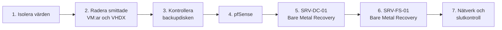

# Procedur A – återställning efter ransomware

**Scenario:** alla virtuella maskiner är krypterade eller obrukbara efter ett ransomware-angrepp. Hyper-V-värden, den externa backupdisken och molnbackupen är oskadda. I labbet simulerades det genom att alla VM:ar raderades (Del 2 av uppgiften).



## 1. Isolera

Kontrollera att Hyper-V-värden är helt bortkopplad från det externa nätverket: dra ur den fysiska WAN-kabeln.

## 2. Radera den smittade miljön

- Ta bort pfSense, SRV-DC-01 och SRV-FS-01 i Hyper-V Manager.
- Radera alla tillhörande `.vhdx`-filer från lagringsdisken, så att ingen skadlig kod ligger kvar i de gamla mapparna.

## 3. Kontrollera backupen

Se till att den externa backupdisken inte var ansluten medan krypteringen pågick, innan den kopplas in i värden.

## 4. Återställ pfSense

1. Skapa en ny tom VM i Hyper-V och starta från en pfSense-ISO. En standardinstallation tar ungefär två minuter.
2. Logga in i pfSense webbgränssnitt från administratörsdatorn och gå till **Diagnostics → Backup & Restore**.
3. Importera `config.xml` från det krypterade USB-minnet. Brandväggsregler och nätverksgränssnitt kommer då tillbaka direkt.
4. Låt maskinen vara isolerad, utan WAN-kabel.

**Alternativ metod: via en FAT32-disk och pfSense-skalet**

1. Skapa en virtuell FAT32-disk och kopiera `config.xml` till den.
2. Installera pfSense, starta om och anslut disken.
3. Kopiera konfigurationen permanent från pfSense-skalet:

```sh
mkdir -p /mnt/da1
mount -t msdos /dev/da1s1 /mnt/da1
cp /mnt/da1/config.xml /cf/conf/config.xml
```

4. Starta om pfSense. Disken kan sedan kopplas bort.

## 5. Återställ SRV-DC-01 med Bare Metal Recovery

1. Skapa en ny tom VM för domänkontrollanten (generation 2).
2. Montera en Windows Server-ISO och starta från den.
3. Välj **Reparera datorn** längst ned till vänster i första fönstret.
4. Gå till **Felsök → Återställning av systemavbildning**.
5. Gör backupdisken tillgänglig för VM:en via Hyper-V SCSI. Låt guiden hitta mappen `WindowsImageBackup`, välj det senaste rena datumet och slutför.
6. Starta maskinen och kontrollera AD och DNS.

## 6. Återställ SRV-FS-01 med Bare Metal Recovery

1. Skapa en tom VM för filservern, montera Windows Server-ISO:n och starta.
2. **Reparera datorn → Felsök → Återställning av systemavbildning**, och välj backupen på den externa disken.
3. Windows Server Backup partitionerar den virtuella disken och återställer operativsystemet och datavolymerna med NTFS-behörigheterna kvar.

Starta filservern först när SRV-DC-01 är helt igång, så att domänanslutning och autentisering fungerar.

## 7. Nätverk och slutkontroll

- Anslut WAN-kabeln först när alla servrar har startat, är kontrollerade och virusskanningen inne i VM:arna är klar utan anmärkning.
- Kontrollera gränssnittstilldelningen i pfSense-konsolen (`hn0` och `hn1`).
- Kontrollera på SRV-DC-01 att Network Location Awareness visar **Domain Network** och inte Public Network, som kan få brandväggen att blockera trafik.
- De nya VM:arna får nya nätverkskort med nya MAC-adresser, och Windows flyttar inte över de gamla inställningarna. Korten står därför på DHCP. Logga in lokalt på SRV-DC-01 och SRV-FS-01 och sätt statisk IP-adress, nätmask, gateway och DNS på det nya kortet (ofta *Ethernet 2*) enligt [IP-planen](disaster-recovery-plan.md#ip-plan).

## Verifiering före normal drift

Incident Commander bockar av:

- [ ] **IP-adresser:** WKS-PC-01 får en adress i 192.168.21.100–199 från DHCP-servern på SRV-DC-01.

  > **Rättelse:** originalet nämnde pfSense som DHCP-server här, men enligt IP-planen ligger scopet på SRV-DC-01.
- [ ] **Routing och DNS:** klienten når internet, och `ping gtrix.se` svarar.
- [ ] **Inloggning:** de 20 testanvändarna från CSV-filen kan logga in på domänen.
- [ ] **Filer och behörigheter:** `\\SRV-FS-01\Share` går att nå, och användarna har sina vanliga läs- och skrivbehörigheter.
- [ ] **Backup:** Windows Server Backup är inställt igen i den nya miljön, med första körningen samma kväll.
