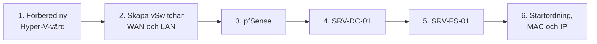

# Procedur B – återställning till en ny värd

**Scenario:** den fysiska Windows 11-datorn som kör Hyper-V har kraschat. Hela miljön ska byggas upp på en annan dator från de externa säkerhetskopiorna. I labbet återställdes VM:arna till en annan dator (Del 3 av uppgiften).



## 1. Förbered den nya värden

Datorn måste köra Windows 11 Pro eller Enterprise. Slå på Hyper-V under **Aktivera eller inaktivera Windows-funktioner**, eller i en administrativ PowerShell:

```powershell
Enable-WindowsOptionalFeature -Online -FeatureName Microsoft-Hyper-V -All
```

Starta om och se till att operativsystem och drivrutiner är uppdaterade.

## 2. Skapa de virtuella switcharna – kritiskt steg

Skapa två switchar i Hyper-V Virtual Switch Manager med exakt samma namn som tidigare:

| Namn | Typ | Kopplad till |
| --- | --- | --- |
| `WAN` | External | Det fysiska nätverkskortet med internet |
| `LAN` | Private eller Internal | Isolerat nät för servrarna |

Om namnen skiljer sig minsta lilla kopplas VM:arnas nätverkskort inte in automatiskt vid återställningen.

## 3. Återställ pfSense

Samma steg som i [procedur A, steg 4](procedur-a-ransomware.md#4-återställ-pfsense): ny VM, pfSense-ISO, sedan import av `config.xml` i webbgränssnittet eller via en FAT32-disk.

## 4. Återställ SRV-DC-01

1. Skapa en tom VM: generation 2, 4 GB RAM, 2 vCPU.
2. Koppla in den externa backupdisken och ge den till VM:en som *Physical Disk* (disken måste vara offline på värden), eller montera den som en virtuell hårddisk.
3. Starta från Windows Server-ISO:n och välj **Reparera datorn → Felsök → Återställning av systemavbildning**.
4. Välj backupen på den externa disken.

## 5. Återställ SRV-FS-01

Skapa den tomma filservern på samma sätt, starta från ISO:n och kör **Reparera datorn → Felsök → Återställning av systemavbildning** för att läsa in operativsystem och fildata.

## 6. Startordning, MAC-adresser och nätverksprofil

Hyper-V skapar nya MAC-adresser på den nya hårdvaran. Starta maskinerna i strikt ordning:

1. **pfSense** – vänta tills routing och tjänster är igång.
2. **SRV-DC-01** – vänta tills AD, DNS och DHCP är helt laddade.
3. **SRV-FS-01**

Därefter:

- Kontrollera gränssnittstilldelningen `hn0`/`hn1` i pfSense-konsolen.
- Kontrollera att Network Location Awareness på SRV-DC-01 visar **Domain Network**.
- Sätt statisk IP-adress, nätmask, gateway och DNS på det nya nätverkskortet på varje server enligt [IP-planen](disaster-recovery-plan.md#ip-plan), eftersom korten startar på DHCP.

Avsluta med samma [verifiering som i procedur A](procedur-a-ransomware.md#verifiering-före-normal-drift).
